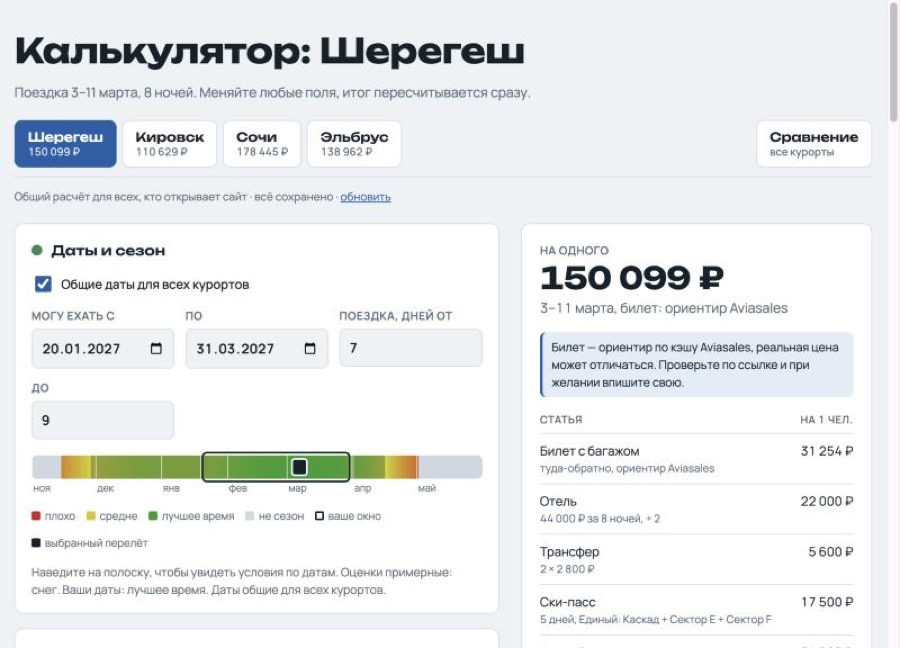
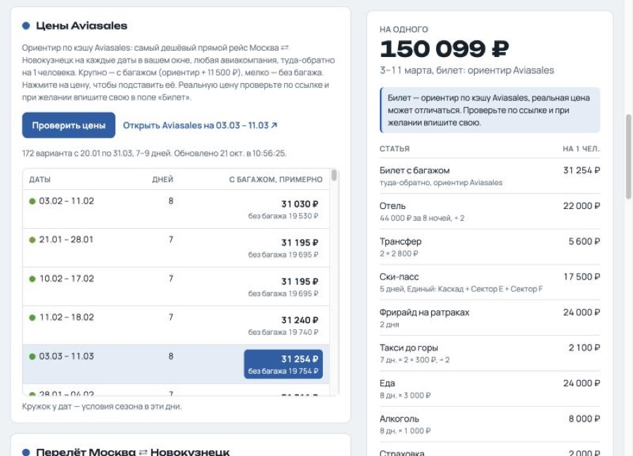
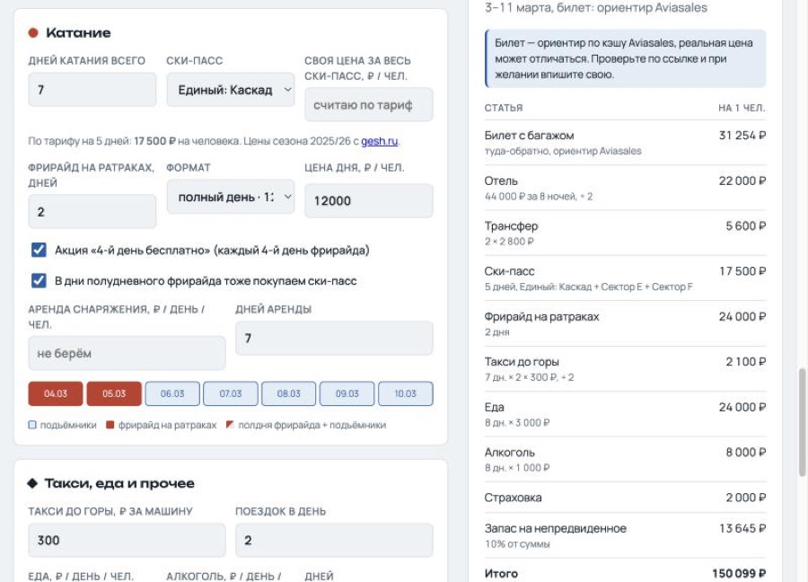
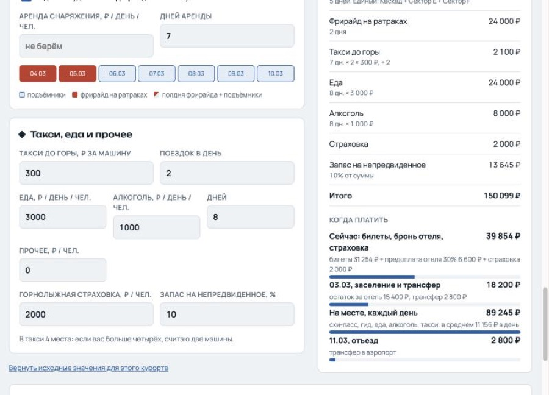
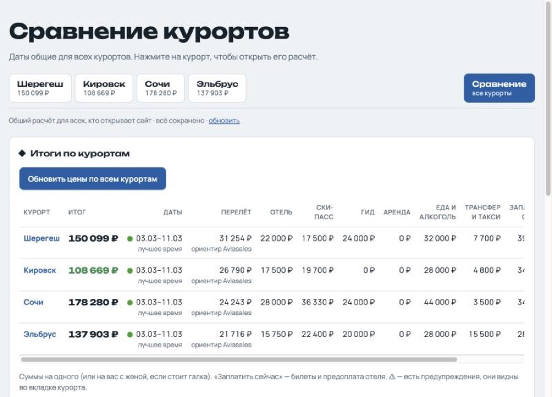
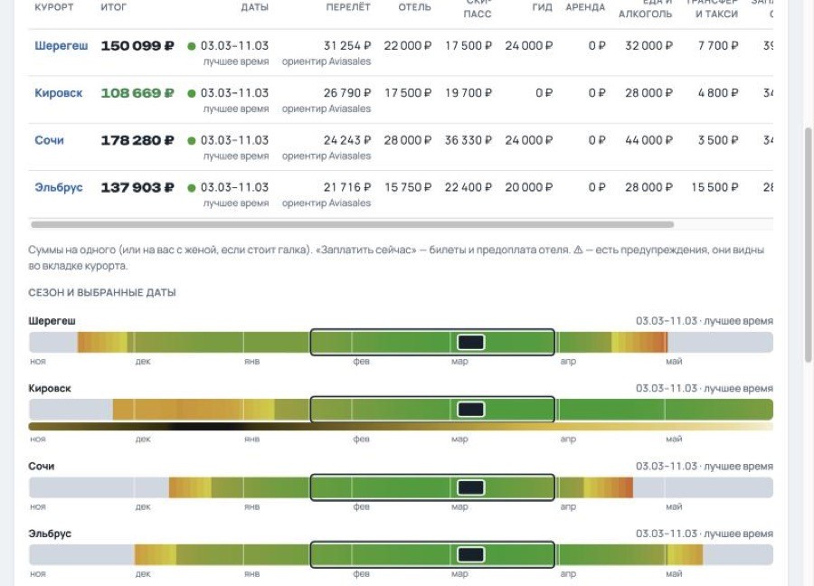
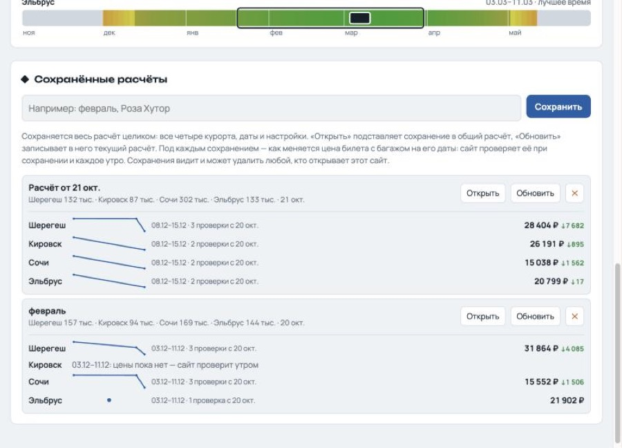
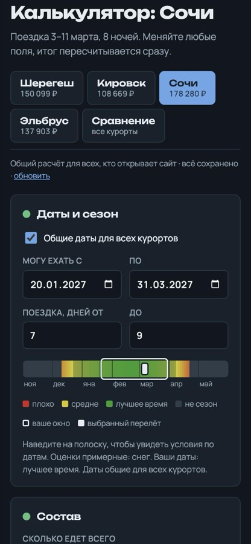
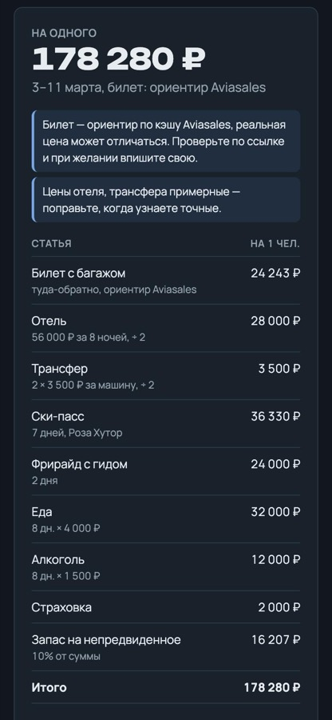

# Калькулятор гор

Сайт, который считает, во сколько обойдётся горнолыжная поездка из Москвы, и помогает выбрать курорт и даты.
Курорты: **Шерегеш, Кировск (Хибины), Сочи (Красная Поляна) и Эльбрус**.

**Сайт:** https://kalkulyator-sheregesha.vercel.app



## Что умеет

### Полный бюджет поездки
Каждая статья расходов считается отдельно, итог справа пересчитывается сразу при любом изменении:

- **Билет** — туда-обратно, с багажом и лыжами или без;
- **Отель** — цена за весь срок, как на агрегаторах, или за ночь. Номер можно делить на всех;
- **Трансфер** из аэропорта — с человека или за машину (в машину помещается 4 человека);
- **Ски-пасс** — по тарифам курорта, с многодневными абонементами и сезонными ценами;
- **Гид или фрирайд** — для Шерегеша фрирайд на ратраках с акцией «каждый 4-й день бесплатно»;
- **Аренда снаряжения, такси до горы, еда, алкоголь, страховка, прочее**;
- **Запас на непредвиденное** в процентах.

Галка **«Еду с женой»** считает всё за двоих и даёт отдельный номер.

### Цены на билеты
Кнопка **«Проверить цены»** подтягивает самые дешёвые прямые рейсы из Москвы на все даты в выбранном окне.
Нажатие на цену подставляет её в расчёт. Ссылка открывает поиск Aviasales с этими датами, чтобы проверить живую цену перед покупкой.



### Ски-пасс и дни катания
Можно выбрать тариф курорта, и сумма посчитается сама: многодневные абонементы, сезонные цены по датам.
Если знаете точную цену, впишите свою. Под полями видна раскладка дней: какие дни на подъёмниках, а какие с гидом.



### Когда и сколько платить
Расходы разложены по времени:
- что платить **сейчас** (билеты, предоплата отеля, страховка);
- что **при заселении**;
- сколько уйдёт **на месте** (в среднем за день);
- что **при отъезде**.



### Сравнение курортов
Вкладка «Сравнение» показывает все четыре курорта одной таблицей: итог, перелёт, отель, ски-пасс, гид, еда, транспорт, что платить сейчас и на месте.
Самый дешёвый курорт подсвечен.



### Сезон и условия
Цветная полоска на каждом курорте показывает сезон с ноября по май: от красного (плохо) к зелёному (лучшее время).
На ней отмечены ваше окно дат (рамкой) и выбранный перелёт.
У Кировска есть отдельная полоска светового дня, чтобы было видно полярную ночь.
При наведении видны условия на конкретную дату.



### Сохранения и график цен
Можно сохранить весь расчёт по всем курортам под своим названием, а потом открыть, обновить или удалить (удаление можно отменить).
Под каждым сохранением видно, **как меняется цена билета на его даты**.
Первая проверка проходит при сохранении, дальше сайт сам проверяет цены каждое утро.



### Общий расчёт
Расчёт общий для всех, кто открывает сайт: правки одного видит другой.
Расчёт подтягивается при открытии сайта и при возврате на вкладку, правки сохраняются через несколько секунд.

### Подсказки и предупреждения
Сайт подсказывает, если:
- мало денег на еду;
- даты выходят за сезон или условия плохие;
- поездка попадает на полярную ночь или новогодние праздники;
- цена билета не для выбранных дат;
- цена отеля введена за другое число ночей.

### На телефоне
Сайт удобно работает с телефона. Его можно добавить на экран «Домой» как приложение.

<p>
  
  
</p>

## Откуда данные

| Что | Откуда |
|---|---|
| Билеты | Кэш цен Aviasales: самый дешёвый прямой рейс на даты, любая авиакомпания. Это ориентир. Авиакомпанию лента не отдаёт, а некоторых рейсов (например, S7 в Сочи) в ней нет. Перед покупкой проверяйте по ссылке |
| Доплата за багаж | Замер в живом поиске Aviasales: Шерегеш +11 500 ₽, Кировск +6 700 ₽, Сочи +7 500 ₽, Эльбрус +7 800 ₽ |
| Ски-пассы | [gesh.ru](https://gesh.ru/sheregesh/skipass/), [bigwood.ru](https://bigwood.ru/ski-pass/), [ridertrip.ru](https://ridertrip.ru/polyana/ski-pass/), [resort-elbrus.ru](https://resort-elbrus.ru/products). Цены сезона 2025/26, у Эльбруса 2026/27 |
| Сезон, отели, гиды, трансферы | Примерные оценки, на сайте помечены «примерно». Стоит уточнять |

## Как устроено

Обычная HTML-страница без сборки и несколько серверных функций на Vercel.

```
index.html          — вся страница: вёрстка, стили и логика расчёта
api/prices.js       — цены Aviasales на окно дат + запись истории цен
api/saves.js        — сохранённые расчёты (с историей цен по их датам)
api/live.js         — общий текущий расчёт
api/cron.js         — ежедневная проверка цен (vercel.json → crons, 8:00 МСК)
api/_aviasales.js   — запросы к Aviasales и история цен
api/_store.js       — JSON-файлы в Vercel Blob
docs/screenshots/   — скриншоты для этого описания
```

Данные лежат в Vercel Blob в нескольких JSON-файлах (`data/saves.json`, `data/live.json`, `data/history.json`).
У бесплатного тарифа есть лимиты: 10 000 чтений и 2 000 записей в месяц. Поэтому сайт не опрашивает сервер постоянно.

Настройки курортов (аэропорт, доплата за багаж, тарифы ски-пассов, сезон, цены по умолчанию) — объект `RES` в `index.html`.

## Запуск и выкладка

Каждый push в `main` сам выкладывается на Vercel.

Локально:
```
npm i
vercel link && vercel env pull
vercel dev
```

Коммиты нужно подписывать адресом GitHub (`…@users.noreply.github.com`), иначе Vercel блокирует деплой.
